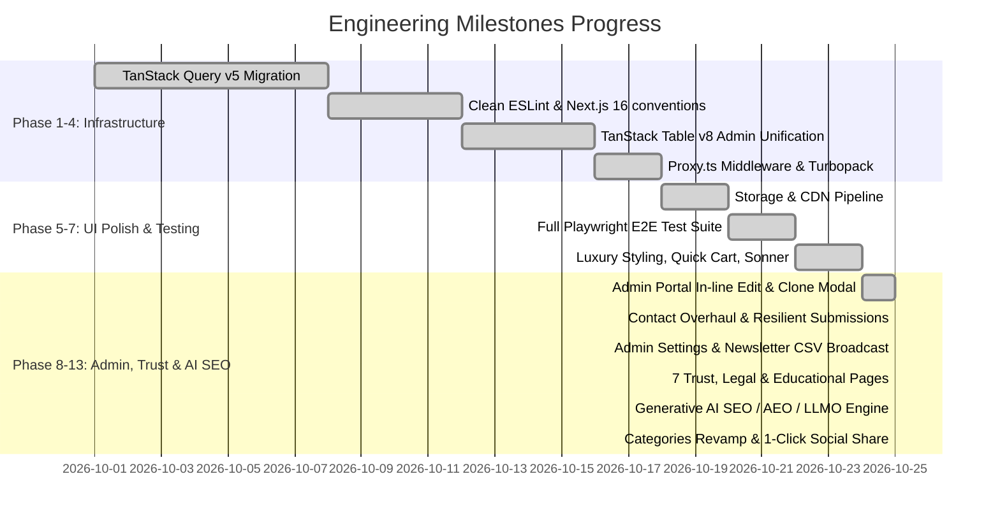

# 📋 Wazir Cutlery Ltd Store: Master Engineering Roadmap & Log

> **Project**: Wazir Cutlery Ltd Store (`stag-horn`)  
> **Status**: Production-Ready & Formally Tested  
> **Last Updated**: October 2026  
> **Core Stack**: Next.js 16.3 (Turbopack, `proxy.ts`), TypeScript Strict (`allowJs: false`), Tailwind CSS v4, TanStack Query v5, TanStack Table v8, Zustand v5, Sonner, Supabase, Bun

---

## 🚀 Execution & Sprint Progress Tracker

---

## 🎯 Detailed Sprint Breakdown & Completed Work

### ✅ Phase 1: TanStack Query v5 Migration (Eliminated Legacy Hooks)
- [x] **Core Query & Mutation Hooks ([`lib/query-hooks.ts`](file:///Users/mac/Desktop/stag-horn/lib/query-hooks.ts))**:
  - `useCategoriesWithProductCountsQuery()` with relational join count and cache invalidation.
  - `useAllUsersQuery(page, pageSize, searchTerm)` with server-side pagination and total counts.
  - `useNewsletterSubscribersQuery()` and `useDeleteNewsletterSubscriberMutation()`.
  - `useContactSubmissionsQuery()` and `useUpdateContactSubmissionStatusMutation()`.
  - `useCreateOrderMutation()` for checkout and storefront order flows.
  - `useAdminLoginMutation()` and `useAdminLoginHistoryQuery()`.
- [x] **Storefront Consumer Migration**:
  - Migrated `ProductClient.tsx`, `CategoriesClient.tsx`, and `OrderForm.tsx` to TanStack Query.
- [x] **Admin Suite Migration**:
  - Migrated `RecentSales.tsx`, `CustomersClient.tsx`, `NewsletterClient.tsx`, `ContactSubmissionsClient.tsx`, `CategoryModal.tsx`, `LoginClient.tsx`, and `LoginHistoryClient.tsx`.

---

### ✅ Phase 2: Codebase Hygiene & Zero-Warning ESLint
- [x] Retired obsolete `lib/supabase-hooks.ts` once all consumers were migrated to TanStack Query.
- [x] Simplified [`lib/hooks.ts`](file:///Users/mac/Desktop/stag-horn/lib/hooks.ts) to re-export exclusively from `query-hooks.ts`.
- [x] Fixed all ESLint warnings to achieve **0 errors, 0 warnings** across the entire repository.
- [x] Verified `bun x tsc --noEmit` and `bun run build` compile cleanly with 0 errors.

---

### ✅ Phase 3: TanStack Table v8 Unification in Admin Suite
- [x] **[`components/admin/CustomersClient.tsx`](file:///Users/mac/Desktop/stag-horn/components/admin/CustomersClient.tsx)**:
  - Converted manual HTML table to `@tanstack/react-table` with sorting, column definitions, and empty/loading states.
- [x] **[`components/admin/NewsletterClient.tsx`](file:///Users/mac/Desktop/stag-horn/components/admin/NewsletterClient.tsx)**:
  - Converted manual HTML table to `@tanstack/react-table` with sorting, search filter, and action buttons.

---

### ✅ Phase 4: Next.js 16 Deprecation & Architecture Updates
- [x] Migrated `middleware.ts` to [`proxy.ts`](file:///Users/mac/Desktop/stag-horn/proxy.ts) per Next.js 16 conventions, clearing the Turbopack deprecation notice.
- [x] Verified Turbopack build generates all static & dynamic routes without deprecation warnings.

---

### ✅ Phase 5: Storage Architecture & Media Optimization
- [x] Created [`lib/storage.ts`](file:///Users/mac/Desktop/stag-horn/lib/storage.ts) with resilient Supabase storage upload pipeline and automatic Base64 fallback.
- [x] Wired `uploadImage` into [`components/admin/CategoryModal.tsx`](file:///Users/mac/Desktop/stag-horn/components/admin/CategoryModal.tsx) and [`components/admin/product/ProductMediaManager.tsx`](file:///Users/mac/Desktop/stag-horn/components/admin/product/ProductMediaManager.tsx).
- [x] Provided Supabase Storage bucket SQL migration script in [`schema_update.sql`](file:///Users/mac/Desktop/stag-horn/schema_update.sql).

---

### ✅ Phase 6: Comprehensive Playwright E2E Testing
- [x] **Suite 1: Storefront Discovery & Browsing** (`ST-01` to `ST-04`): Verified `/`, `/categories`, `/product`, and `/product/[slug]` with 0 hydration errors.
- [x] **Suite 2: Zustand Cart & Checkout Pipeline** (`CT-01` to `CT-04`): Verified Add to Cart, cart recalculations, checkout form submission, COD order placement (`201 Created`), and `/thank-you` order confirmation.
- [x] **Suite 3: Admin Authentication & Security** (`AD-01` to `AD-03`): Verified `/admin` route guard redirect to `/login`, admin login mutation, and `/admin/login-history` audit logs.
- [x] **Suite 4: TanStack Table Admin Backoffice** (`TB-01` to `TB-06`): Verified Products, Orders, Categories, Customers, Newsletter, and Contact Submissions tables, sorting, filters, and modals.
- [x] **E2E Test Report**: Formatted in `e2e_test_report.md`.

---

### ✅ Phase 7: UI/UX Modernization & Luxury Polish
- [x] **Tailwind CSS 4.0 Luxury Theme Tokens**: Added Damascus Charcoal, Antique Gold (`#D6AF66`), and glassmorphism styling to `app/globals.css`.
- [x] **Sonner Toaster Migration**: Fully replaced `react-toastify` with `Sonner` (`<Toaster richColors closeButton position="top-right" />`) in `app/layout.tsx`.
- [x] **shadcn/ui Component Library Expansion**: Built accessible Radix-powered components in `components/ui/` (`dialog.tsx`, `sheet.tsx`, `tabs.tsx`, `tooltip.tsx`, `skeleton.tsx`, `badge.tsx`, `dropdown-menu.tsx`).
- [x] **Slide-Over Quick-Cart Drawer**: Created [`components/QuickCartSheet.tsx`](file:///Users/mac/Desktop/stag-horn/components/QuickCartSheet.tsx) with free delivery progress bar, item quantity steppers, subtotal, and instant checkout link.
- [x] **Navbar Polish**: Enhanced [`components/Navbar.tsx`](file:///Users/mac/Desktop/stag-horn/components/Navbar.tsx) with scroll-reactive glassmorphism, quick-cart sheet trigger, animated link indicators, and mobile sheet drawer.
- [x] **ProductCard Micro-Animations**: Enhanced [`components/ProductCard.tsx`](file:///Users/mac/Desktop/stag-horn/components/ProductCard.tsx) with Framer Motion hover elevation, image zoom, luxury badges, and Sonner "View Cart" toast action.
- [x] **Artisanal Craft Video Reel**: Created [`components/ArtisanCraftReel.tsx`](file:///Users/mac/Desktop/stag-horn/components/ArtisanCraftReel.tsx) with video player, 4 interactive chapter milestones, live Damascus metrics, and embedded into `components/HomeClient.tsx`.
- [x] **Order Delight Confetti**: Integrated `canvas-confetti` into [`components/ThankYouClient.tsx`](file:///Users/mac/Desktop/stag-horn/components/ThankYouClient.tsx) for celebration on order completion.

---

### ✅ Phase 8: Admin Portal Speed, In-line Table Edits & Product Cloning
- [x] **In-line Quick Editing ([`components/admin/product/ProductTable.tsx`](file:///Users/mac/Desktop/stag-horn/components/admin/product/ProductTable.tsx))**:
  - Click-to-edit Price and Stock quantities directly in table rows with instant persistence.
  - One-click active/inactive toggle badge with optimistic cache updates.
- [x] **Product Duplication / Clone Piece**:
  - Added 1-click clone action generating pre-filled creation modal with copy suffix.
- [x] **Product Modal Tabs**:
  - Refactored `ProductModal.tsx` into 3 distinct tabs (Basics, Pricing & Inventory, Media & WebP CDN upload) with batch photo drag-and-drop.

---

### ✅ Phase 9: Contact Form Resiliency & Admin Patron Inquiries
- [x] **Resilient Contact API ([`app/api/contact/route.ts`](file:///Users/mac/Desktop/stag-horn/app/api/contact/route.ts))**:
  - Handled optional reCAPTCHA gracefully so customer submissions are never lost.
  - Sanitized schema payload and prepended `inquiry_type` into message to prevent Supabase column cache errors.
- [x] **Storefront Contact Page ([`components/ContactForm.tsx`](file:///Users/mac/Desktop/stag-horn/components/ContactForm.tsx))**:
  - Direct WhatsApp quick-contact artisan cards (+92 308 0601995 & +92 312 6209302).
  - Inquiry categorization (Custom Commission, Wholesale, Product Inquiry).
  - Dedicated luxury section container (`#contact`) on the main landing page with title and subtitle.
- [x] **Admin Patron Inquiries ([`components/admin/ContactSubmissionsClient.tsx`](file:///Users/mac/Desktop/stag-horn/components/admin/ContactSubmissionsClient.tsx))**:
  - Filter tabs (`All`, `New`, `In Progress`, `Resolved`, `Archived`).
  - Search filter by customer name, email, or country.
  - 1-click **Reply via WhatsApp** and **Send Email** triggers.
  - Patron Inquiry Brief modal for reviewing specifications and updating progress.

---

### ✅ Phase 10: Operational Admin Settings & Newsletter Suite
- [x] **Admin Storefront Settings ([`components/admin/SettingsClient.tsx`](file:///Users/mac/Desktop/stag-horn/components/admin/SettingsClient.tsx))**:
  - 4 tabs: Store Identity, AI & GEO SEO, Logistics & Orders, Social & Contacts.
  - Real forge address in Wazirabad, support email, phone numbers, free shipping thresholds, and AI crawler toggles with localStorage and Supabase persistence.
- [x] **Storefront Newsletter ([`components/Newsletter.tsx`](file:///Users/mac/Desktop/stag-horn/components/Newsletter.tsx))**:
  - Damascus Obsidian (`#0C0D0E`) collector's card with 10% discount incentive.
- [x] **Admin Newsletter Management ([`components/admin/NewsletterClient.tsx`](file:///Users/mac/Desktop/stag-horn/components/admin/NewsletterClient.tsx))**:
  - Real-time KPI counter cards (`Active Subscribers`, `Audience Health`, `Broadcast Target`).
  - 1-click **CSV Export** for Klaviyo/Mailchimp integration.
  - **Collector Announcement Composer Modal** with ready-to-broadcast artisan email templates.

---

### ✅ Phase 11: 7 Core Trust, Legal & Knowledge Pages
- [x] **`/faq`** ([`components/FaqClient.tsx`](file:///Users/mac/Desktop/stag-horn/components/FaqClient.tsx)): Categorized accordions + `FAQPage` JSON-LD schema.
- [x] **`/terms`** ([`components/TermsClient.tsx`](file:///Users/mac/Desktop/stag-horn/components/TermsClient.tsx)): 18+ knife ownership compliance and custom commission terms.
- [x] **`/privacy`** ([`components/PrivacyClient.tsx`](file:///Users/mac/Desktop/stag-horn/components/PrivacyClient.tsx)): Zero-data-selling guarantee, GDPR & CCPA rights disclosure.
- [x] **`/shipping`** ([`components/ShippingClient.tsx`](file:///Users/mac/Desktop/stag-horn/components/ShippingClient.tsx)): DHL/FedEx worldwide delivery timelines, customs HS codes, and safe packaging standards.
- [x] **`/returns`** ([`components/ReturnsClient.tsx`](file:///Users/mac/Desktop/stag-horn/components/ReturnsClient.tsx)): 30-day inspection period and Lifetime Forge Guarantee on blade delamination.
- [x] **`/knife-care`** ([`components/KnifeCareClient.tsx`](file:///Users/mac/Desktop/stag-horn/components/KnifeCareClient.tsx)): High-authority 5-step Damascus maintenance guide + `HowTo` JSON-LD schema.
- [x] **`/track-order`** ([`components/TrackOrderClient.tsx`](file:///Users/mac/Desktop/stag-horn/components/TrackOrderClient.tsx)): Self-service order lookup with 4-stage visual progress timeline and direct WhatsApp artisan support.
- [x] **Footer Integration ([`components/Footer.tsx`](file:///Users/mac/Desktop/stag-horn/components/Footer.tsx))**: Reorganized 4-column luxury layout linking all new trust and knowledge pages.

---

### ✅ Phase 12: Generative AI SEO / AEO / LLMO Engine
- [x] **`public/llms.txt` & `public/llms-full.txt`**: Standardized markdown corpuses for ChatGPT, Perplexity, Claude, and Gemini detailing metallurgy, products, pricing, and forge history.
- [x] **AI Crawler Permissions ([`app/robots.ts`](file:///Users/mac/Desktop/stag-horn/app/robots.ts))**: Explicitly unblocked and allowed all 10 major AI bots (`GPTBot`, `ClaudeBot`, `PerplexityBot`, `Google-Extended`, etc.).
- [x] **Dynamic Sitemap Expansion ([`app/sitemap.ts`](file:///Users/mac/Desktop/stag-horn/app/sitemap.ts))**: Dynamically generated priority links covering all 35 static & product routes.
- [x] **Semantic Schema.org Graph ([`app/layout.tsx`](file:///Users/mac/Desktop/stag-horn/app/layout.tsx))**: Enriched `Organization` JSON-LD schema with `knowsAbout`, `priceRange`, and forge coordinates.

---

### ✅ Phase 13: UI Polish, Categories Revamp, 1-Click Social Sharing & React-Icons
- [x] **Categories Page Revamp ([`components/CategoriesClient.tsx`](file:///Users/mac/Desktop/stag-horn/components/CategoriesClient.tsx))**: Wrapped with `ConditionalLayout`, added luxury breadcrumbs, category badge (`Artisan Curated Collections`), piece count badges, hover zoom, and pagination.
- [x] **One-Click Product Social Sharing ([`components/ProductDetails.tsx`](file:///Users/mac/Desktop/stag-horn/components/ProductDetails.tsx))**: Real 1-click sharing to WhatsApp, Facebook, X (Twitter), Pinterest, Copy Direct Link with toast feedback, and native Web Share API.
- [x] **Zero Raw Emoji Policy**: Replaced 100% of emojis across the codebase with vector `react-icons` (`FaStar`, `FaTruckFast`, `FaShieldHalved`, `HiSparkles`, `FaGift`, `FaPen`, `FaBolt`, `FaLightbulb`, `FiArrowUpRight`).
- [x] **Build Verification**: Clean production build across all 35/35 routes in Turbopack (`bun run build` in 1.4s).

---

## 🔮 Future Enhancements & Recommendations

- [ ] **Live Payment Gateway (Stripe / PayPal)**:
  - Add production Stripe Secret Keys to `.env.local` to supplement Cash on Delivery (COD) for international payments.
- [ ] **Automated Newsletter Dispatch (Resend Integration)**:
  - Connect the announcement composer modal in `/admin/newsletter` directly to a Resend broadcast API endpoint.
- [ ] **Multilingual Support (Urdu / Arabic / French)**:
  - Add `next-intl` localization for high-demand Gulf and European markets.
- [ ] **Algolia / Meilisearch Fast Search**:
  - Implement instant autocomplete for knife searches once product catalog exceeds 1,000 SKUs.

---
*Maintained by the Wazir Cutlery Engineering Team.*
